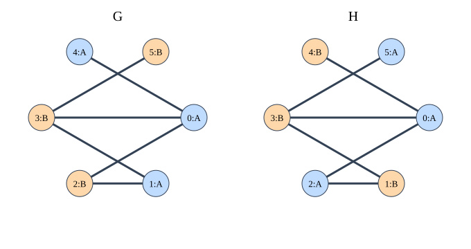
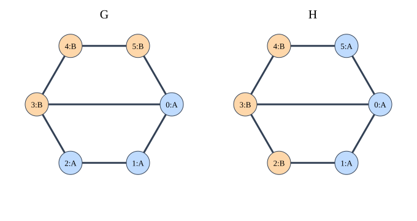
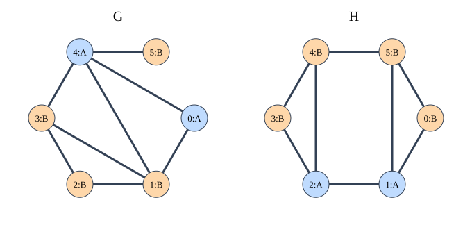

# Task 2(d) — Expressivity search

We tested 7958 binary label assignments across 143 connected atlas graphs with one to six vertices. Assignments equivalent under relabeling were allowed during generation. We grouped graphs by their shortest-path and ordinary GraphHopper features, then found 22 groups with more than one multiplicative feature vector.

Shortest-path features count each ordered pair of distinct reachable endpoints once. Ordinary GraphHopper counts labels at individual positions of shortest paths. Multiplicative GraphHopper counts entire label sequences. Both GraphHopper counters include length zero. Distances below are squared differences between the count vectors.

## Pair 1

Squared distances in the order shortest-path, ordinary GraphHopper, and multiplicative GraphHopper are **(0, 0, 28)**.
The sequence **A–A–B** occurs 2 time(s) in G and 3 time(s) in H.
Edges in G: [(0, 2), (0, 3), (0, 4), (1, 2), (1, 3), (3, 5)]. Edges in H: [(0, 2), (0, 3), (0, 4), (1, 2), (1, 3), (3, 5)].

## Pair 2

Squared distances in the order shortest-path, ordinary GraphHopper, and multiplicative GraphHopper are **(0, 0, 20)**.
The sequence **A–A–A–B** occurs 1 time(s) in G and 2 time(s) in H.
Edges in G: [(0, 1), (0, 3), (0, 5), (1, 2), (2, 3), (3, 4), (4, 5)]. Edges in H: [(0, 1), (0, 3), (0, 5), (1, 2), (2, 3), (3, 4), (4, 5)].

## Pair 3

Squared distances in the order shortest-path, ordinary GraphHopper, and multiplicative GraphHopper are **(0, 0, 64)**.
The sequence **A–A–B** occurs 2 time(s) in G and 4 time(s) in H.
Edges in G: [(0, 1), (0, 4), (1, 2), (1, 3), (1, 4), (2, 3), (3, 4), (4, 5)]. Edges in H: [(0, 1), (0, 5), (1, 2), (1, 5), (2, 3), (2, 4), (3, 4), (4, 5)].

## Checks against Task 2(a)

The two-edge example gave distances (16, 0, 16), confirming that ordinary GraphHopper can miss a distinction captured by the multiplicative version. The square-and-lines example gave (16, 0, 0), confirming that the shortest-path kernel can distinguish graphs with equal multiplicative features. These disconnected examples were checked separately from the atlas search.

For discrete labels, the general implication from Task 2(a) follows because the ordinary GraphHopper counts can be recovered by summing the full sequence counts at each position. The atlas search illustrates this comparison on a finite collection.
